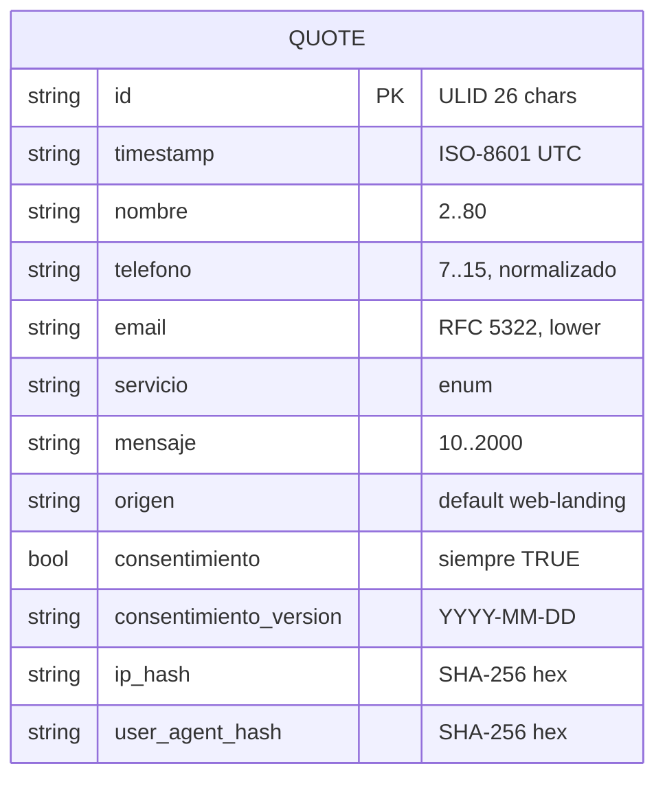

version: 1.1 | fecha: 2026-10-02 | estado: aprobado (post-auditoría R2)
arq_leída: 2.0 (2026-10-02)
contratos: `docs/contracts/data-model.md` v2 (dueño: database), `docs/contracts/env.md` v1

# database/PLAN.md — Metalúrgica del Caribe

## 1. Motor y justificación

**Driver primario:** Google Sheets API v4.
**Driver alterno:** archivo `.xlsx` (ExcelJS) en disco local o OneDrive del dueño, seleccionable por `DB_DRIVER=sheets|excel`.

**Por qué no una RNBD / NoSQL:**
- Volumen esperado: < 10 cotizaciones/día (≈ 3.600/año, ≈ 7.200 en los 24 meses de retención). Esto cabe cómodamente en una hoja (límite de Sheets: 10 M celdas, 10 columnas × 7.200 filas = 72.000 celdas, el 0,72 % del límite).
- El dueño quiere **ver y editar** las cotizaciones directamente desde su navegador sin instalar nada. Sheets es la UI gratuita.
- No hay consultas analíticas complejas, ni JOINs, ni concurrencia alta de escritura.
- Backend aísla la persistencia detrás de `QuoteRepository`, por lo que migrar a Postgres cuando el volumen lo justifique (> 100 k/mes, ADR-003 de ARCHITECTURE) es un trabajo acotado al paquete `database/`.

**Governance ha validado** que RNBD no aplica dado el bajo volumen y el perfil de uso.

## 2. Diagrama ER

Entidad única, sin relaciones. Cada envío = 1 fila.

## 3. Esquema de la hoja `quotes`

Las **13 columnas** (A..M), su tipo y reglas están en `database/schema/quotes.sheet.md` v2 y en `docs/contracts/data-model.md` v2. Resumen de los cambios post-R2 respecto a v1:

- **L `user_agent_hash`** confirmado (SHA-256 hex 64). AU-C-01 cerrado.
- **C `nombre`** longitud 2..120 (antes 80). AU-M-08 cerrado.
- **M `ultimo_contacto`** nueva columna, ISO-8601 UTC opcional, vacía al crear. Resuelve §5 contradicción 3 y habilita retención real a 24 meses medida como `MAX(timestamp, ultimo_contacto)` (AU-H-02).

## 4. Convenciones de nombres

- Nombres de columna = nombres de campo JSON del API, idénticos y en snake_case:
  `timestamp`, `id`, `nombre`, `telefono`, `email`, `servicio`, `mensaje`, `origen`, `consentimiento`, `consentimiento_version`, `ip_hash`, `user_agent_hash`.
- Orden físico en la hoja: A..L según `data-model.md` + delta.
- **Minimización (Ley 1581):** `ip_hash` y `user_agent_hash` sustituyen la IP y el UA originales. Nunca persistimos los valores crudos. El salting con `IP_HASH_SALT` (32 bytes) hace el hash no reversible por rainbow table. Finalidad: antiabuso y detección de duplicados; no identificación directa.

## 5. Formato de `id`: ULID

**ULID (26 chars Crockford base32)** sobre UUID v4:

| Criterio | ULID | UUID v4 |
|---|---|---|
| Ordenable por tiempo | **Sí** (los primeros 48 bits son timestamp ms) | No (aleatorio) |
| Longitud | 26 | 36 |
| Legible / seleccionable con doble-clic | **Sí** | Con guiones, parte |
| Colisión práctica | Prácticamente nula (80 bits random) | Nula (122 bits) |
| URL-safe | **Sí** sin encoding | Sí |

Al leer la hoja ordenada alfabéticamente por `id`, se obtiene orden cronológico de llegada sin tener que ordenar por `timestamp`. Útil para el dueño que mira el Sheet a ojo.

## 6. Validaciones en celda (Google Sheets data validation)

Al crear la hoja se aplican estas validaciones (manual o por script, idempotente):

| Columna | Validación |
|---|---|
| F `servicio` | Lista desplegable: `residencial`, `comercial`, `industrial`, `portones`, `barandas`, `mobiliario`, `otro`. Rechazar entrada inválida. |
| I `consentimiento` | Casilla con `TRUE`/`FALSE`. Rechazar `FALSE`. |
| J `consentimiento_version` | Regex `^\d{4}-\d{2}-\d{2}$`. |

La validación es defensa en profundidad; la validación primaria la hace backend con Zod antes de llegar aquí.

## 7. Formato de fecha

`timestamp` se guarda como **texto ISO-8601 UTC** (`2026-10-02T14:35:22.123Z`), no como fecha nativa de Sheets. Razones:
- Sheets interpreta fechas según la zona horaria del Spreadsheet y el locale del dueño; esto corrompe el valor al mostrarlo (p. ej. convierte a GMT-5 Barranquilla).
- `valueInputOption=RAW` fuerza string literal.
- El exportado CSV mantiene el valor bit a bit.

## 8. Protección de la hoja

| Permiso | Quién |
|---|---|
| Escritura (editor) | Service Account del backend (`client_email` del `GOOGLE_SA_JSON`), compartido explícitamente al Spreadsheet; no a la carpeta. |
| Lectura (viewer) | Cuenta Gmail del dueño `[PENDIENTE_USUARIO]`. |
| Nada | Resto del mundo. Link sharing deshabilitado. |

**Riesgos del hosting en cuenta Gmail personal (no Workspace):**
- **Legal (Ley 1581):** PII bajo cuenta personal del dueño implica que la cuenta Gmail es un activo crítico de la empresa. Governance lo clasifica como riesgo legal menor.
- **Mitigaciones obligatorias documentadas aquí y en governance:**
  1. 2FA obligatorio en la cuenta Gmail del dueño (con llave física o Authenticator, no SMS).
  2. El Service Account solo tiene permiso sobre **ese** Spreadsheet (no Drive completo, no carpeta padre).
  3. Export semanal `.xlsx` a una segunda cuenta (empresarial o Drive separado) como backup externo e independiente.
  4. Rotación anual de la credencial del Service Account (procedimiento en README).
  5. Si en algún momento el negocio escala y entra personal adicional, migrar a Workspace empresarial (ADR futuro).

## 9. Backups (RPO 24 h)

- **Export semanal CSV + XLSX a Drive** del dueño, carpeta `/backups/metalurgica/`.
- Devops lo ejecuta (OPS-06). Mecanismo recomendado: Apps Script con trigger temporal, o `gcloud` + `curl` desde CI programado. Formato: `quotes-YYYY-MM-DD.csv` y `.xlsx`.
- Verificación mensual manual: abrir el último backup, contar filas, comparar con hoja viva.
- **RPO declarado:** 7 días en el peor caso; cumple el RPO 24 h de ARCHITECTURE §5 **solo si el export es diario**. Delta pendiente: subir cadencia a diaria o aceptar RPO 7 d. Lo marco en §12.

## 10. Anonimización a 24 meses (CMP-04)

Job manual trimestral — **implementado en `scripts/anonymize.ts`** (post-R2):

1. Edad efectiva de cada fila = `MAX(timestamp, ultimo_contacto)`. Esto permite que un contacto reciente extienda la retención, como define governance (`retencion-y-borrado.md`).
2. Si edad efectiva > 24 meses, se reemplazan columnas C `nombre`, D `telefono`, E `email`, K `ip_hash`, L `user_agent_hash` por `***`.
3. Se conserva A `id`, B `timestamp`, F `servicio`, G `mensaje`, H `origen`, I `consentimiento`, J `consentimiento_version`, M `ultimo_contacto`.
4. Flujo obligatorio en dos pasos: primero `--dry-run` genera `anonymize-log-YYYY-MM-DD.csv` para que governance audite; luego `--dry-run --apply` ejecuta el `batchUpdate`. `--apply` sin `--dry-run` está prohibido por el script.
5. Idempotente: filas ya `***` se saltan como `skip-already-anon`.
6. Log sin PII: solo `row_number`, `id` (ULID público), `effective_date`, `action`, `reason`.

Nota sobre G `mensaje`: el script v1 **no** redacta el texto libre. Governance ha aceptado el riesgo (es texto operacional corto, y la revisión manual del dueño puede marcar mensajes sensibles para borrado puntual). Si en futuro se exige, se añade un escaneo regex como fase 2 (ver §12 observaciones nuevas).

Procedimiento operativo detallado: governance (GOV-06).

## 11. Cuotas, latencias y plan de contingencia

**Google Sheets API v4:**
- 60 req / min / usuario (service account cuenta como un usuario).
- 300 req / min / project.
- Volumen esperado: < 10 escrituras/día. **Headroom: ~8.000x**. No es cuello de botella.

**Escenario de burst** (bot/ataque, 1.000 req/min):
- Primero lo frena el rate-limit de Fastify (10 req/min/IP → BE-02).
- Si pasa (varias IP), Sheets devuelve 429 → repository hace **3 reintentos con backoff exponencial** (200 ms, 800 ms, 3.200 ms + jitter).
- Si los tres fallan: `503` al cliente y encolado local JSONL (BE-06). Reintento en background.

**Latencia observada `values.append`:** 300–800 ms típico, hasta 1.500 ms en p95.
- Backend responde sync hoy. Si p95 supera 1.000 ms persistente (NFR), migrar a 202 async: devolver `id` tras generar ULID y escribir en Sheets en background (ya es el patrón que marca ARCHITECTURE §7 flujo paso 6).
- `ping()` usa `spreadsheets.get` liviano (sin leer celdas), latencia típica 100–250 ms.

## 12. Deltas detectados contra contratos

1. **Columna L: `user_agent` → `user_agent_hash`.** Motivo: minimización Ley 1581. **RESUELTO en R2:** architect subió `data-model.md` a v2, el schema `quotes.sheet.md` v2 confirma `user_agent_hash` y el delta documental queda cerrado (AU-C-01).
2. **Firma de repositorio: `save(quote): Promise<void>` → `append(quote): Promise<{ id }>`.** Motivo: el backend necesita confirmar que el `id` quedó efectivamente escrito antes de responder 202. **IMPLEMENTADO.**
3. **RPO 24 h vs export semanal.** **RESUELTO en R2:** devops migra el cron a diario (`0 3 * * *`). Database documenta la expectativa; propiedad operativa queda en OPS-06.
4. **Nombre de archivo del esquema.** El stub pedía `schema.sheets.md`; usuario pidió `schema/quotes.sheet.md`. **IMPLEMENTADO.**

### Deltas resueltos tras R2 (2026-10-02)

- **AU-C-01** — `user_agent_hash` confirmado en schema v2 y en código. Cerrado.
- **§5 contradicción 3** — columna M `ultimo_contacto` añadida; `createQuote` la inicializa a `""`; `touch(id)` disponible en la interfaz y en ambos drivers. Cerrado.
- **AU-M-01** — `scripts/anonymize.ts` entregado con flujo dry-run → apply, log CSV sin PII, idempotencia y batchUpdate. Cerrado.
- **AU-M-08** — columna C `nombre` sube a 2..120 en el schema físico para alinear con Zod. Cerrado.

### Observaciones nuevas (R2)

- **O-R2-01 (bajo):** `scripts/anonymize.ts` **no** redacta PII incrustada en G `mensaje`. Es una decisión consciente (texto operativo corto, bajo riesgo). Si governance eleva el nivel de exigencia, se añade una fase 2 con regex de email/teléfono. Documentado en §10.
- **O-R2-02 (bajo):** `GoogleSheetsRepository.touch(id)` hace dos llamadas por operación (`values.get(A:A)` + `values.update(M<row>)`). Con el volumen esperado (<10 touch/día) la cuota de 60 req/min queda holgada. Si el volumen sube, migrar a `developerMetadata` o cachear índice `id → row` en memoria.
- **O-R2-03 (medio):** la columna M en Google Sheets puede quedar fuera del rango de la fila devuelta por `values.get` si está vacía (Sheets recorta trailing empties). `anonymize.ts` ya normaliza a 13 columnas antes de reescribir; `touch` solo escribe M por lo que no se ve afectado. Comportamiento verificado contra la doc de Sheets v4.

## 13. Preguntas abiertas

- Email Gmail del dueño para compartir el Sheet con permiso de lectura (`[PENDIENTE_USUARIO]`).
- `SHEET_ID` real una vez el dueño cree el Spreadsheet con `scripts/seed-headers.ts`.
- `UA_HASH_SALT` separado (añadido al env.md v2 por architect). **Resuelto.**
- Cadencia de backup diaria. **Resuelto:** devops aplica cron diario.
- ¿Quién/qué va a invocar `QuoteRepository.touch(id)` en producción? Hoy ningún camino lo llama; el método está disponible y testeable. Cuando backend defina el flujo "registrar contacto" (futuro CR), se conectará. Mientras tanto, `scripts/anonymize.ts` tolera columna M vacía.
