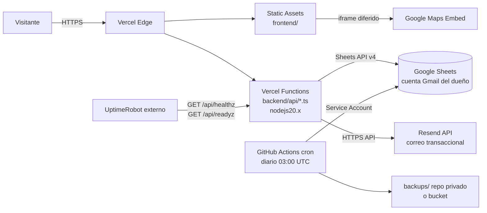

# devops/PLAN.md — Metalúrgica del Caribe

version: 1.1 | fecha: 2026-10-02 | arq_leída: 2.0 (2026-10-02) · round 2 post-audit
contratos: `docs/contracts/env.md`
dueño: devops

## 0. Decisiones del usuario (sobrescriben ARCHITECTURE.md)

- **Hosting unificado: Vercel.** Sin Docker, sin docker-compose, sin PaaS tradicional (Render/Fly/Railway).
- **Dominio final: pendiente.** Todo URL va parametrizada con placeholders `[PENDIENTE_USUARIO: dominio]` y `[PENDIENTE_USUARIO: dominio-preview]`.
- **Proveedor de correo inicial: Resend.** SMTP queda como fallback documentado en el backend.
- **Google Sheets vive en cuenta personal del dueño (Gmail).** Governance ya documentó el riesgo PII; devops implementa backup externo semanal obligatorio.
- **Node runtime en Vercel: 20.x.**

## 1. Topología



**Componentes clave:**
- Frontend estático (`frontend/`) servido por Vercel desde la CDN global.
- Backend Fastify+TS adaptado a **Vercel Functions** (handler serverless, no proceso long-running). Montado bajo `/api/*`.
- Google Sheets como persistencia externa (cuenta personal del dueño).
- Resend como proveedor de correo transaccional.
- UptimeRobot (free) como monitor externo para `/api/healthz` y `/api/readyz`.
- GitHub Actions con cron **diario** para backup del Sheet (RPO 24 h, AU-H-01).

**Puertos:** no aplica. Vercel enruta HTTP(S) a las funciones automáticamente.

## 2. Entornos

| Entorno | Rama | URL | Variables | Propósito |
|---------|------|-----|-----------|-----------|
| `development` | local | `http://localhost:3000` | `.env.local` (gitignored) | Desarrollo con `vercel dev` |
| `preview` | cada PR | `[PENDIENTE_USUARIO: dominio-preview]` (auto-generada por Vercel) | Vercel UI → Preview | Validación por PR; Sheet distinto si procede |
| `production` | `main` | `https://[PENDIENTE_USUARIO: dominio]` | Vercel UI → Production | Dominio final del cliente |

**Reglas de variables:**
- Las variables se definen **en la UI de Vercel**, nunca en el repo. Vercel permite marcarlas por entorno (Development / Preview / Production).
- Secretos (`GOOGLE_SA_JSON`, `RESEND_API_KEY`, `SMTP_PASS`, `IP_HASH_SALT`): marcar como "Sensitive" en Vercel.
- Variables públicas del frontend (`MAPS_API_KEY`, `API_BASE_URL`, `SITE_URL`): deben llevar prefijo `NEXT_PUBLIC_` solo si se usara Next.js; aquí el frontend es estático, se inyectan en build via `vercel build` o se leen desde `window.__ENV__` servido por una función.
- `.env.example` en el repo documenta **nombres y comentarios**, nunca valores.

## 3. Hosting

**Elegido: Vercel (decisión del usuario).**

| Aspecto | Valor |
|---------|-------|
| Región funciones | `iad1` (Washington, US East) por defecto; cambiar a `gru1` (São Paulo) para latencia mínima desde Colombia si plan lo permite |
| Residencia de datos | Sheets en Google (US/UE); backend serverless en región Vercel; correo en Resend (US). Documentar en política de privacidad |
| Costo esperado | Hobby plan: USD 0/mes (hasta 100 GB bandwidth, 100k invocaciones func/mes). Suficiente para < 10 k visitas/mes. Pro: USD 20/mes/usuario si se requiere mayor timeout o uso comercial |
| Timeout función | 10 s en Hobby, 60 s en Pro. Sheets append típico 300-800 ms → suficiente |
| Cold start | 300-800 ms típico. Documentado como riesgo R1 |

## 4. Pipeline CI/CD

**División de responsabilidades:**
- **GitHub Actions** (`.github/workflows/ci.yml`): calidad de código → lint, typecheck, tests. No despliega.
- **Vercel GitHub Integration**: despliega automáticamente. Cada push a `main` → production. Cada PR → preview con URL única.

**Pipeline por PR (`ci.yml`):**
1. Checkout.
2. Setup Node 20 con cache de npm.
3. Install (`npm ci`) en workspaces `backend/` y `database/`.
4. Lint (`eslint`) en backend y database.
5. Typecheck (`tsc --noEmit`) en backend y database.
6. Tests (`vitest run` si existen; skip graceful si no hay).
7. Audit (`npm audit --omit=dev --audit-level=high`): warning, no bloquea aún.

**Deploy Vercel (automático):**
- `main` → production (dominio final).
- Cualquier otra rama / PR → preview.
- Vercel instala y buildea según `vercel.json`.

**Backup del Sheet (`sheet-backup.yml`) — round 2 (AU-H-01):**
- Cron **diario** 03:00 UTC (antes: semanal). Cumple RPO 24 h.
- Autentica con Service Account (`GOOGLE_SA_JSON` en GitHub Secrets).
- Exporta hoja `quotes` a CSV con `curl` a Sheets API v4.
- Guarda en `backups/quotes-YYYY-MM-DD.csv` del repo.
- Los domingos duplica el export en `backups/weekly/quotes-YYYY-MM-DD-weekly.csv`.
- Retencion escalonada: diarios 30 d + semanales 52 w (purga automatica en el workflow).

## 5. Gestión de secretos

| Secreto | Dónde vive | Scope |
|---------|-----------|-------|
| `GOOGLE_SA_JSON` | Vercel UI (prod + preview) + GitHub Secrets (para backup) | server-side |
| `RESEND_API_KEY` | Vercel UI | server-side |
| `SMTP_PASS` | Vercel UI (si se activa SMTP) | server-side |
| `IP_HASH_SALT` | Vercel UI | server-side |
| `MAPS_API_KEY` | Vercel UI (público, restringido por HTTP referrer) | client-side |

**Reglas:**
- `.env` y `.env.local` en `.gitignore`. `.env.example` sí se commitea (solo nombres).
- Escaneo con `gitleaks` opcional en el futuro (añadir a `ci.yml` cuando se integre).
- Rotación: `IP_HASH_SALT` nunca; `RESEND_API_KEY` cada 12 meses o ante incidente; Service Account solo si se filtra.

## 6. Observabilidad

| Capa | Herramienta | Qué captura |
|------|-------------|-------------|
| Logs de función | Vercel Logs (built-in) | `console.log` JSON por línea, retención según plan (Hobby 1 h, Pro 1 día; integrar Datadog/Logtail luego si crece) |
| Uptime | UptimeRobot free (50 monitores, 5 min polling) | `GET /api/healthz` y `GET /api/readyz` cada 5 min (AU-C-02: rutas con prefijo `/api/*`, Vercel no reescribe) |
| Métricas | Vercel Analytics (free tier) | TTFB, Core Web Vitals |
| Alertas | UptimeRobot → email al dueño | tras 2 fallos consecutivos |

**Formato de logs esperado del backend** (contrato con backend):
```json
{"level":"info","time":"2026-10-02T12:00:00Z","msg":"quote_saved","quote_id":"01HXYZ...","duration_ms":450}
```

Sin PII en texto claro. Email/teléfono enmascarados (lo garantiza backend BE-06).

**Monitores UptimeRobot — paths canónicos (AU-C-02):**
- `GET https://[dominio]/api/healthz` → espera `200` (liveness; sin dependencias externas).
- `GET https://[dominio]/api/readyz` → espera `200` (readiness; verifica Sheets + Resend reachable).
- NO usar `/healthz` ni `/readyz` sin prefijo: Vercel no reescribe, retornarían 404.
- Umbral: 2 fallos consecutivos → alerta a `OWNER_EMAIL` (o `UPTIME_ALERT_EMAIL` si se separa, D9).

## 7. Respaldos y recuperación

**Alineado con RPO 24 h / RTO 4 h de ARCHITECTURE.md §5:**

| Qué | Cómo | Frecuencia | Retención |
|-----|------|-----------|-----------|
| Hoja `quotes` (diario) | GitHub Actions cron → export CSV via Sheets API | **Diario 03:00 UTC** | 30 días en `backups/` |
| Hoja `quotes` (semanal) | Mismo workflow duplica el export del domingo | Domingo 03:00 UTC | 52 semanas en `backups/weekly/` |
| Configuración Vercel | Export manual del dashboard | Trimestral | Documentada en `devops/vercel-config.md` (crear tras primer deploy) |
| Código | GitHub propio del cliente | Continuo | Infinito |

**Política de retención consolidada (round 2):**
- Diarios cubren el RPO 24 h de ARCHITECTURE.md §5 (AU-H-01).
- Los semanales (52) dan un horizonte histórico de 1 año sin inflar el repo (1 CSV/semana ≈ 50 KB · 52 ≈ 2.6 MB).
- La purga la ejecuta el propio workflow (`find -mtime +30` y `-mtime +364`), idempotente.
- Backups en repo privado del cliente; no se replican a bucket externo por ahora (deuda si crece volumen).

**Procedimiento de restore (RTO 4 h):**
1. Detectar incidente (Sheet corrompido / borrado).
2. Dueño confirma en Google Drive papelera (resguardo nativo 30 días).
3. Si no está, recuperar último CSV de `backups/`.
4. Crear nuevo Sheet, importar CSV, actualizar `SHEET_ID` en Vercel UI.
5. Redeploy manual (Vercel UI → "Redeploy").

Primer ensayo de restore: documentar al mes 1 post-launch (checklist en `devops/dns/README.md` sección Runbook — crear al cerrar).

## 8. DNS y correo transaccional

Mientras no haya dominio, el sitio vive en `[PENDIENTE_USUARIO: dominio-preview]` (`*.vercel.app`). Checklist completo cuando se adquiera dominio en `devops/dns/README.md`:

- Vercel: `A @ 76.76.21.21` (o CNAME según guía Vercel actual).
- Resend: TXT con selector DKIM `[PENDIENTE_USUARIO: dkim-selector]`.
- SPF: `v=spf1 include:_spf.resend.com -all`.
- DMARC: `v=DMARC1; p=quarantine; rua=mailto:dmarc@[PENDIENTE_USUARIO: dominio]`.
- Verificación: `dig TXT [PENDIENTE_USUARIO: dominio] +short` y `dig TXT _dmarc.[PENDIENTE_USUARIO: dominio] +short`.

## 9. Riesgos abiertos

- **R1 Cold starts (300-800 ms).** Las funciones Vercel en Hobby se duermen. Mitigación: UptimeRobot cada 5 min mantiene calentada la función `healthz` (efecto lateral útil). Si cold start se vuelve problema → upgrade a Pro con "Fluid Compute" o migrar a edge functions (requiere adaptar Fastify).
- **R2 Rate-limit sin estado.** Fastify in-memory no persiste entre invocaciones serverless. Opciones:
  - **(a) Recomendada:** Upstash Redis free tier (10 k comandos/día) con `@upstash/ratelimit`. Añade `UPSTASH_REDIS_URL` y `UPSTASH_REDIS_TOKEN` a env. Backend coordina.
  - **(b) Fallback aceptable:** sin rate-limit real. Honeypot + Zod + consentimiento obligatorio cubren bots básicos. Documentar como deuda.
  - **(c) Rate-limit de Vercel:** disponible en Enterprise, no aplica.
- **R3 Cuota Sheets API** (300 req/min/project). Para < 10 k visitas/mes sobra. Vigilar.
- **R4 PII en Gmail personal del dueño.** Riesgo documentado por governance (CMP-05 extendido). Devops implementa backup externo como mitigación, pero el riesgo de acceso no autorizado a la cuenta Gmail persiste. Recomendación: 2FA obligatorio en la cuenta del dueño.
- **R5 Resend sin dominio verificado.** Los correos iniciales saldrán desde `onboarding@resend.dev` o similar. Antes del lanzamiento público verificar dominio y configurar SPF/DKIM/DMARC.
- **R6 Timeout 10 s en Hobby.** Si Sheets latencia pico supera 8 s (bloqueo transitorio), la función corta. Mitigación: timeout interno a 7 s en backend + reintento asíncrono fuera de banda (fuera del request del visitante).

## 9bis. Runbook E2E (round 2, AU-B-05 + §8 preparación E2E)

### Local

Requisito previo: Node 20, repo instalado, `.env.local` configurado (puedes copiar los stubs del job CI).

```bash
# Terminal A: arranca backend + frontend en modo serverless local
cd backend
TEST_MODE=1 npm run start:test     # driver in-memory, no toca Sheets/Resend
# Alternativa integrada:
# vercel dev                        # requiere `vercel login` y vincular proyecto

# Terminal B: corre Playwright
cd e2e
npm ci
npx playwright install
npx playwright test                  # las 3 engines
npx playwright test --project=chromium
npx playwright test --ui             # UI mode interactivo
```

Variables mínimas para arrancar backend en `TEST_MODE=1` (no son secretos reales):

```
TEST_MODE=1
NODE_ENV=test
IP_HASH_SALT=test-ip-salt-not-secret
UA_HASH_SALT=test-ua-salt-not-secret
CONSENT_VERSION=2026-10-02
MAIL_PROVIDER=resend
RESEND_API_KEY=re_test_stub
OWNER_EMAIL=owner@test.local
FROM_EMAIL=no-reply@test.local
DB_DRIVER=sheets
SHEET_ID=test-sheet-id
SHEET_TAB=quotes
GOOGLE_SA_JSON={}
CORS_ORIGIN=http://localhost:3000
```

### En CI

- Job `e2e` en `.github/workflows/ci.yml`.
- Dispara: **push a `main`** o **PR con label `run-e2e`** (ahorro de minutos GH Actions).
- Matriz: `chromium × firefox × webkit`.
- Pasos: setup Node 20 → `npm ci` → `playwright install --with-deps` → `npm run start:test` en background con healthcheck → `npx playwright test --project=<browser>` → sube `test-results/` y `playwright-report/` como artefacto 7 d si falla.
- Depende de `lint-and-typecheck` (no corre si lint o typecheck fallan).

### Driver `TEST_MODE=1` (contrato con backend)

- Backend lee `process.env.TEST_MODE === '1'` en el bootstrap y sustituye:
  - cliente Sheets por un store Map in-memory,
  - cliente Resend por un no-op que registra el payload,
  - cliente Upstash (si está configurado) por un contador in-memory.
- El contrato lo implementa backend (BE); devops solo garantiza que la env llega a la función.

### Troubleshooting

- Si Playwright se queda esperando `/api/healthz`: revisar que `npm run start:test` esté levantando el handler Vercel en `localhost:3000`. Alternativa: `vercel dev`.
- Si WebKit falla en Linux CI: ya se instalan dependencias con `--with-deps`.
- Artefactos de fallo: descargar desde la pestaña del run → `playwright-<browser>-<run_id>`.

## 10. Deltas detectados contra ARCHITECTURE.md

Devops no edita ARCHITECTURE.md. Audit debe sincronizar lo siguiente:

| Sección arq | Dice | Realidad por decisión usuario |
|-------------|------|-------------------------------|
| §7 Arquitectura (diagrama) | Backend sobre PaaS con Docker | Vercel Functions serverless |
| §8 Stack · Hosting BE | "PaaS (Render / Fly / Railway) con contenedor Docker" | Vercel Functions `nodejs20.x` |
| §8 Stack · Hosting FE | "CDN estático (Netlify/Vercel/Cloudflare Pages)" | Vercel (consolidado con backend) |
| §14 Backlog · OPS-01 | "Dockerfile multi-stage + docker-compose" | **Eliminado.** Vercel no usa contenedores en Hobby/Pro |
| §14 Backlog · OPS-02 | "deploy al PaaS" | Vercel integración nativa; GH Actions solo CI |
| §11 Seguridad · Rate-limit | "10 req / min / IP" in-memory | Requiere Upstash Redis o aceptar deuda (R2) |
| §13 R-5 (nuevo) | — | Añadir riesgo "PII en Gmail personal del dueño" |

### Deltas round 2 (post-audit 2026-10-02)

| ID | Delta | Estado |
|----|-------|--------|
| AU-H-01 | Backup diario (`0 3 * * *`) + retención 30 d / 52 w | **Implementado** en `.github/workflows/sheet-backup.yml` |
| AU-C-02 | Monitores UptimeRobot deben apuntar a `/api/healthz` y `/api/readyz` | **Documentado** §6 |
| AU-C-03 | `.env.example` sincronizado con env.md v2 (default `resend`, `UA_HASH_SALT`, `UPSTASH_*`, `ARCO_EMAIL`) | **Implementado**, con dependencia de bump del architect |
| AU-B-05 | Job `e2e` en CI con matriz 3 browsers y `TEST_MODE=1` | **Implementado** en `.github/workflows/ci.yml` |
| §8 preparación E2E | Runbook local + CI | **Documentado** §9bis |

### Dependencias pendientes del architect

Devops publicó `.env.example` con los nombres acordados en el audit §5 pero **antes** de que el architect confirme el bump de `docs/contracts/env.md` a v2. Si el architect sube `env.md` con nombres distintos (p. ej. `ARCO_CONTACT_EMAIL` en lugar de `ARCO_EMAIL`, o `UPSTASH_REDIS_URL` en lugar de `UPSTASH_REDIS_REST_URL`), devops debe re-sincronizar `.env.example` y el bloque `env:` del job `e2e`. Coordinación: audit arbitra.

Fuente provisional usada (hasta que `env.md` v2 se publique):

- `MAIL_PROVIDER=resend` (default).
- `UA_HASH_SALT` (secreta obligatoria, formato igual a `IP_HASH_SALT`).
- `UPSTASH_REDIS_REST_URL` + `UPSTASH_REDIS_REST_TOKEN` (opcionales, modo degradado documentado).
- `ARCO_EMAIL` (opcional runtime, destino política pública).
- `IP_HASH_SALT` ya presente, se mantiene.

## 11. Preguntas abiertas (para el usuario)

1. ¿Dominio final confirmado? Si sí, cuál y cuándo se adquiere.
2. ¿Aceptar Upstash Redis para rate-limit real (R2), o dejar deuda documentada?
3. ¿Vercel Hobby (gratis) o Pro (USD 20/mes) desde el día 1? Hobby sirve; Pro desbloquea timeout 60 s y mejores logs.
4. ¿Backup semanal en el mismo repo (carpeta `backups/` privada) o en bucket externo (S3/R2)?
5. Email destino de las alertas de UptimeRobot: ¿`OWNER_EMAIL` o uno separado?
