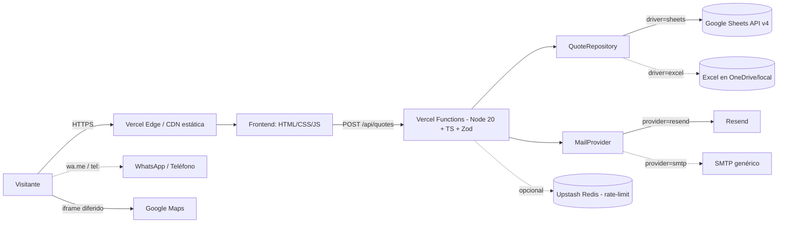

version: 2.1 | fecha: 2026-10-02 | estado: aprobado

# ARCHITECTURE — Metalúrgica del Caribe (sitio web + backend ligero)

## 1. Resumen ejecutivo
Sitio web para una empresa de herrería y metalistería en Barranquilla (Colombia). Da presencia digital, muestra servicios y proyectos, y **captura cotizaciones reales**: el formulario escribe en una hoja de Google Sheets y notifica por correo al dueño. Cumple Ley 1581 de 2012 (Habeas Data). Frontend estático de alto rendimiento; backend ligero Node/Fastify con validación estricta y proveedores pluggables de correo y persistencia.

## 2. Usuarios
- **Cliente residencial.** Rejas, puertas, portones, barandas. Llega desde Google o referido.
- **Cliente comercial.** Mobiliario metálico, fachadas, estructuras ligeras.
- **Constructora / contratista.** Estructuras metálicas y cubiertas para obra.
- **Dueño / operador** (no entra al sitio): recibe el correo de notificación y revisa la hoja de Sheets.

## 3. Alcance
**Dentro del MVP (v2)**
- Landing con secciones: inicio, servicios, proyectos, proceso, nosotros, contacto.
- **Formulario de cotización con envío real** a `POST /api/quotes`, validación en cliente y servidor, confirmación en pantalla.
- Galería de proyectos filtrable.
- **Modo claro + modo oscuro** con `data-theme` y `prefers-color-scheme`.
- **Google Maps embebido** en Contacto, carga diferida y bajo consentimiento.
- SEO completo: OG, Twitter Card, JSON-LD `LocalBusiness`, canonical, `robots.txt`, `sitemap.xml`, favicons, manifest.
- Cumplimiento legal: aviso de privacidad, checkbox de consentimiento, política pública.

**Fuera de alcance**
- Autenticación, panel administrativo, blog, catálogo con precios.
- CRM, pasarela de pago.

**Fases futuras**
- CMS ligero para proyectos.
- Integración con CRM / WhatsApp Business API.

## 4. Requisitos funcionales
| ID | Historia | Criterio de aceptación | MoSCoW |
|----|----------|------------------------|--------|
| RF-01 | Ver servicios | 6 servicios con **foto real** (Unsplash), título y descripción | Must |
| RF-02 | Ver proyectos por categoría | Galería filtrable con **foto por obra** | Must |
| RF-03 | Ver el proceso | 4 pasos numerados con **foto por paso** | Must |
| RF-04 | Solicitar cotización | Formulario valida en cliente, envía a `POST /api/quotes`, muestra confirmación con id | Must |
| RF-05 | Contactar directo | Enlaces `tel:` y `wa.me` | Must |
| RF-06 | Navegar en móvil | Menú hamburguesa, targets táctiles ≥ 44 px | Must |
| RF-07 | Ver ubicación | Google Maps embebido en Contacto, diferido y bajo consentimiento | Must |
| RF-08 | Alternar tema | Toggle claro/oscuro, respeta `prefers-color-scheme`, persiste en `localStorage` | Should |
| RF-09 | Consentir el tratamiento de datos | Checkbox no premarcado + link a política antes de enviar PII | Must |
| RF-10 | Dueño recibe la cotización | Correo al `OWNER_EMAIL` + fila nueva en Sheets con id, timestamp y campos | Must |
| RF-11 | SEO local | JSON-LD `LocalBusiness`, OG, Twitter Card, canonical, sitemap, robots | Must |
| RF-12 | PWA mínima | `manifest.webmanifest`, favicon, apple-touch-icon | Could |

## 5. Requisitos no funcionales
- **Rendimiento frontend:** LCP < 2.5 s, INP < 200 ms, CLS < 0.1. Peso HTML+CSS+JS < 180 KB sin fuentes ni imágenes.
- **Rendimiento backend:** p95 `POST /api/quotes` < 1200 ms warm (incluye Sheets + envío de correo asíncrono); cold start Vercel añade 300–800 ms sobre p99. `/api/healthz` < 50 ms warm.
- **Disponibilidad:** 99.5 % mensual.
- **RPO/RTO:** RPO 24 h (export **diario** del Sheet a Drive, cron `0 3 * * *` UTC; retención 30 d diarios + 52 w semanales), RTO 4 h.
- **Retención:** cotizaciones 24 meses, luego anonimización. Logs 30 días.
- **Navegadores:** últimas 2 versiones de Chrome, Edge, Firefox, Safari y Safari iOS. Paridad visual verificada por audit.
- **Dispositivos de referencia (breakpoints 360, 414, 768, 1024, 1280, 1440):** iPhone SE, iPhone 14, iPhone 14 Pro Max, Pixel 7, iPad mini, iPad Air, iPad Pro, Galaxy S, Galaxy Tab.
- **Accesibilidad:** WCAG 2.2 AA. Teclado, contraste ≥ 4.5:1, `prefers-reduced-motion`.
- **Idioma:** español (Colombia).

## 6. Matriz de roles
Un único rol público: **visitante anónimo**. No hay autenticación en el sitio.

| Rol | Recurso | C | R | U | D | Alcance |
|-----|---------|---|---|---|---|---------|
| Visitante | `POST /api/quotes` | sí | — | — | — | propio envío |
| Visitante | contenido público | — | sí | — | — | global |
| Dueño (fuera de la app) | hoja de Sheets | — | sí | sí | sí | global, por acceso directo a Google |

Mínimo privilegio: el service account de backend tiene permiso **solo** sobre el Sheet objetivo (no sobre la carpeta ni el Drive).

## 7. Arquitectura
Estilo: **monolito modular ligero**. Frontend estático + un único servicio backend Fastify. No se usan microservicios (equipo pequeño, un solo dominio).



**Módulos backend** (Vercel Functions, cada uno un handler `api/*.ts`)
- `api/quotes.ts`: `POST /api/quotes`. CORS, honeypot, rate-limit (Upstash si disponible), schema Zod, orquesta repo + mail.
- `api/healthz.ts`: `GET /api/healthz`. Liveness; responde `{status:"ok"}` sin tocar dependencias.
- `api/readyz.ts`: `GET /api/readyz`. Chequea Sheets y mail; responde `{status:"ok"|"degraded", checks:{sheets,mail}}`.
- `lib/persistence`: interfaz `QuoteRepository` + `GoogleSheetsRepository` + `ExcelFileRepository`.
- `lib/mail`: interfaz `MailProvider` + `ResendMailProvider` + `SmtpMailProvider`.
- `lib/rateLimit`: Upstash si envs presentes; fallback best-effort en memoria por instancia.

**Flujo del formulario**
1. Visitante completa el formulario, marca el checkbox de consentimiento.
2. Cliente valida; envía JSON a `POST /api/quotes`.
3. Fastify valida con Zod, revisa honeypot y rate-limit, genera `id` (ULID), timestamp UTC.
4. `QuoteRepository.save(quote)` escribe la fila en Sheets.
5. `MailProvider.send(...)` notifica al `OWNER_EMAIL` (fire-and-forget con reintento).
6. Responde `202 Accepted` con `{ id }`.

## 8. Stack
| Capa | Tecnología | Versión | Razón | Alternativa descartada |
|------|-----------|---------|-------|------------------------|
| Frontend markup | HTML5 semántico | — | mínima superficie, sin build | — |
| Frontend estilos | CSS moderno + tokens `data-theme` | — | modo claro/oscuro nativo | Sass (innecesario) |
| Frontend script | JS vanilla ES2020 | — | landing sin estado complejo | React/Vue (sobreingeniería) |
| Backend | **Node.js + TypeScript + Zod en Vercel Functions** | Node 20, Zod 3 | tipos end-to-end, validación declarativa, cero infra para operar | Fastify PaaS (Render/Fly) — se descartó por operabilidad (ver ADR-003); Hono (ecosistema menor); NestJS (sobreingeniería) |
| Persistencia | Google Sheets API v4 (default) · Excel xlsx (alterno) | — | el usuario quiere ver cotizaciones en Sheets | PostgreSQL (correcto técnicamente pero el usuario pidió explícitamente Sheets/Excel) |
| Correo | Resend (default) · Nodemailer SMTP (alterno) | — | pluggable por env; Resend más simple y con DKIM/DMARC manejado | SES (añade AWS innecesariamente) |
| Rate-limit | Upstash Redis REST (opcional) | — | compatible con serverless, pay-per-request; modo degradado si no se configura | Memcached (requiere infra persistente) |
| Hosting FE+BE | **Vercel** (static assets + Functions en la misma plataforma) | — | gratuito en Hobby para este volumen; HTTPS, CDN y despliegues preview automáticos | Netlify (igualmente válido); PaaS con Docker (sobreingeniería para 1 endpoint) |
| Observabilidad | `console.*` structured JSON → Vercel Logs; UptimeRobot sobre `/api/healthz` | — | lo que Vercel ya emite, sin stack adicional | Pino en runtime Edge no soportado; ELK sobredimensionado |

**Residencia de datos:** Sheets se aloja en Google (US/UE según cuenta); Vercel Functions corren en regiones US por defecto; Resend US; Upstash según región elegida (preferir `us-east-1` para colocación). Documentado en política de privacidad (governance). No se almacena PII fuera de Sheets.

## 9. Modelo de dominio
Una sola entidad.

```
Quote
  id (ULID)
  timestamp (ISO 8601 UTC)
  nombre
  telefono
  email
  servicio (enum: residencial | comercial | industrial | portones | barandas | mobiliario | otro)
  mensaje
  origen (string, p. ej. "web-landing")
  consentimiento (bool, siempre true si llega aquí)
  consentimiento_version (string, p. ej. "2026-10-02")
```

El esquema físico (columnas de Sheets, tipos) está en `docs/contracts/data-model.md` (dueño: database).

## 10. Integraciones externas
| Servicio | Propósito | Criticidad | Qué pasa si cae |
|----------|-----------|------------|------------------|
| Google Sheets API v4 | Persistencia primaria de cotizaciones | Alta | El backend reintenta 3 veces; si falla, responde 503 y encola localmente (archivo JSONL) para reintento posterior |
| Proveedor de correo (SMTP o Resend) | Notificación al dueño | Media | Falla silenciosa con log; la cotización ya quedó en Sheets, no se pierde |
| Google Maps JS API | Mostrar ubicación en Contacto | Baja | Degrada a enlace estático a Google Maps |
| Google Fonts | Oswald + Inter | Baja | Fallback de sistema |
| Unsplash (hotlink o descarga) | Fotografía de servicios/proyectos/proceso | Baja | Fallback a imagen local pre-descargada |

## 11. Seguridad y cumplimiento

### Seguridad backend
- **CORS** acotado a `CORS_ORIGIN` (dominio público del sitio).
- **Helmet** con CSP estricta compatible con el frontend.
- **Rate-limit**: 10 req / minuto / IP sobre `POST /api/quotes`.
- **Validación** declarativa con Zod; rechaza campos extra.
- **Honeypot**: campo oculto `website`; si viene lleno, 202 falso sin persistir.
- **HTTPS** obligatorio (PaaS lo garantiza).
- **Secretos** solo en variables de entorno; nunca en repo.
- **Logs** estructurados JSON sin PII (email/teléfono se enmascaran: `j***@g***.com`).
- **Dependencias**: `npm audit` en CI, actualización mensual.

### Cumplimiento (Ley 1581 de 2012, Decreto 1377 de 2013)
Governance redacta los documentos; la arquitectura garantiza que:
- **CMP-01** Consentimiento previo, expreso e informado → checkbox no premarcado + versión guardada por fila (RF-09).
- **CMP-02** Finalidad declarada → política pública enlazada desde el checkbox y footer.
- **CMP-03** Derechos ARCO (acceso, rectificación, cancelación, oposición) → canal `OWNER_EMAIL` publicado en la política.
- **CMP-04** Retención limitada → 24 meses; anonimización posterior (job manual trimestral descrito en governance).
- **CMP-05** Seguridad razonable → cifrado en tránsito (HTTPS), acceso restringido al Sheet por service account.
- **CMP-06** Registro ante la SIC si la BD supera umbrales → responsabilidad del dueño (governance explica cuándo aplica).
- **CMP-07** Cookies y terceros (Google Maps) solo tras consentimiento → banner condicional antes de cargar el iframe de Maps.
- **CMP-08** El NIT **no se publica** en el sitio; queda en la política de tratamiento (documento legal) y en facturación.

## 12. Escalabilidad por etapas
- **< 1 k visitas/mes (hoy).** Fastify en un dyno pequeño, Sheets como DB. Suficiente.
- **1 k – 100 k.** Añadir cache de assets (CDN ya cubre), elevar rate-limit, considerar cola interna para correos (BullMQ en Redis) si el proveedor de correo pone cuota.
- **> 100 k.** Migrar persistencia a PostgreSQL (Sheets no soporta este volumen: 10 M celdas, 60 reads/min por usuario). Documentado en ADR-003 el camino de migración (QuoteRepository ya aísla la implementación).

## 13. Riesgos y decisiones abiertas
- **R-01 Sheets como DB** no es escalable ni transaccional. Mitigación: driver pluggable, migración planeada (ADR-003).
- **R-02 Cuotas Google Sheets API** (300 req / min / project). Para este volumen sobra; vigilar si crece.
- **R-03 Correos del proveedor acaban en spam.** Mitigación: SPF/DKIM/DMARC configurados por devops (OPS-06 / AU-B-04).
- **R-04 Unsplash cambia hotlinks.** Mitigación: descargar y servir desde CDN propia.
- **R-05 PII en Google Sheets de cuenta Gmail personal del dueño** (AU-H-05). Riesgo operacional de acceso no autorizado si la cuenta cae. Mitigación: exigir 2FA al dueño (D7), service account con permiso solo sobre el Sheet, revisión trimestral de accesos.
- **R-06 Cold starts de Vercel Functions 300–800 ms.** Impacta p99 del primer request tras inactividad. Mitigación aceptada para MVP; si molesta, pasar a Vercel Pro con fluid compute o pre-warming vía UptimeRobot cada 5 min.
- **R-07 Rate-limit requiere Upstash o degrada a best-effort.** En serverless no hay memoria compartida entre invocaciones. Si el usuario rechaza Upstash (D5), el límite por IP deja de ser garantizado y se depende de honeypot + Zod + Vercel edge throttling. Documentado en `env.md`.
- **R-08 Cola JSONL BE-06 fuera de alcance en serverless.** El sistema de archivos de Vercel Functions es efímero por invocación; no se puede encolar en disco. Mitigación: `POST /api/quotes` reintenta 3 veces contra Sheets dentro del timeout; si falla, responde `503` al cliente con `error: persistence_unavailable` para que reintente o use el canal `wa.me`. Se descarta la cola local original.
- **[SUPUESTO]** El dueño tiene cuenta Google con 2FA donde reside el Sheet. Validar con el usuario (D7).
- **[SUPUESTO]** Dominio final `metalurgicadelcaribe.co` (ajustar en CORS, canonical, OG) — pendiente D1.

## 14. Backlog por agente

### Backend (`backend/PLAN.md`)
- BE-01 → RF-04, RF-10 · Endpoint `POST /api/quotes` con Fastify + Zod.
- BE-02 → RF-04 · Honeypot, rate-limit, CORS, Helmet.
- BE-03 → RF-10 · Interfaz `QuoteRepository` + factory por `DB_DRIVER`.
- BE-04 → RF-10 · Interfaz `MailProvider` + factory por `MAIL_PROVIDER` (SMTP y Resend).
- BE-05 → NFR salud · `/healthz`, `/readyz`, logs Pino JSON, `/metrics` opcional.
- BE-06 → CMP-05 · Enmascarado de PII en logs. **Nota (AU-M-05):** la cola local JSONL ante fallo de Sheets queda **fuera de alcance en Vercel Functions** (FS efímero por invocación). Mitigación vigente: 3 reintentos dentro del timeout y respuesta `503 persistence_unavailable` al cliente. Ver R-08.

### Database (`database/PLAN.md`)
- DB-01 → RF-10 · Schema de hoja `quotes` en Google Sheets (columnas y tipos, ver `data-model.md`).
- DB-02 → RF-10 · Implementación `GoogleSheetsRepository` (Service Account, Sheets API v4).
- DB-03 → RF-10 · Implementación `ExcelFileRepository` (xlsx local u OneDrive) como alterno.
- DB-04 → CMP-04 · Procedimiento de anonimización a 24 meses y export semanal (backup).
- DB-05 → NFR · Documentar cuotas, latencias y plan de migración a Postgres.

### DevOps (`devops/PLAN.md`)
- OPS-01 → NFR · Dockerfile multi-stage para backend; `docker-compose.yml` para dev.
- OPS-02 → NFR · CI (GitHub Actions): lint, typecheck, test, build, deploy.
- OPS-03 → RF-11 · Servir `robots.txt` y `sitemap.xml` desde el frontend.
- OPS-04 → RF-12 · Pipeline de favicons + `manifest.webmanifest`.
- OPS-05 → RF-07 · Provisionar `MAPS_API_KEY` con restricción por dominio (HTTP referrer).
- OPS-06 → CMP-05 · HTTPS, SPF/DKIM/DMARC del remitente, backups de Sheets a Drive semanal.
- OPS-07 → NFR · `.env.example` completo (ver `env.md`); alertas básicas (healthcheck + email).

### Governance (`governance/PLAN.md`)
- GOV-01 → CMP-01..08 · Política de Tratamiento de Datos (Ley 1581 + Decreto 1377).
- GOV-02 → CMP-02 · Aviso de Privacidad (resumen visible).
- GOV-03 → CMP-07 · Aviso de cookies / terceros (Maps).
- GOV-04 → CMP-01 · Texto exacto del checkbox de consentimiento + versión.
- GOV-05 → CMP-03 · Canal ARCO documentado (correo del dueño, plazos legales).
- GOV-06 → CMP-04 · Programa de mantenimiento: retención, anonimización, revisión anual.
- GOV-07 → CMP-08 · Documento legal con NIT (fuera del sitio público).
- GOV-08 → CMP-06 · Guía de registro ante la SIC (cuándo aplica, cómo).

### Frontend (`frontend/PLAN.md` — actualización)
- FE-07 → RF-04 · Enviar formulario a `POST /api/quotes`, mostrar id de confirmación, manejar error.
- FE-08 → RF-08 · Modo claro: tokens equivalentes en `tokens.css`, toggle `data-theme`, respeta `prefers-color-scheme`, persiste en `localStorage`.
- FE-09 → RF-01, RF-02, RF-03 · Reemplazar SVG genéricos por **fotografía Unsplash** (textura, oficio, manos, chispas). Mantener blueprint como elemento secundario.
- FE-10 → CMP-01, RF-09 · Checkbox de consentimiento + link a `/politica-privacidad.html`; aviso visible antes de enviar PII.
- FE-11 → RF-07, CMP-07 · Google Maps diferido tras consentimiento; fallback a enlace estático.
- FE-12 → RF-11 · Meta OG/Twitter, canonical, `lang="es-CO"`, JSON-LD `LocalBusiness`.
- FE-13 → RF-12 · Favicon, apple-touch-icon, `manifest.webmanifest`.
- FE-14 → CMP-08 · Retirar NIT del footer.
- FE-15 → NFR · Validar paridad en matriz de dispositivos y breakpoints 360/414/768/1024/1280/1440.
- FE-16 → Personalidad · Reforzar elementos anti-genéricos (hero asimétrico, numeración 01/02 gigante, barra de acento, remaches).

### Audit (al cierre)
- AU-01 · Coherencia entre ARCHITECTURE.md, cada `*/PLAN.md` y los contratos.
- AU-02 · Cross-browser en navegadores objetivo.
- AU-03 · Cumplimiento legal (Ley 1581) verificado contra la implementación.
- AU-04 · Sincronía DB ↔ backend ↔ frontend (nombres de campos idénticos).
- AU-05 · Preparación para E2E del flujo crítico.

## 15. Registro de cambios
- **2.1** (2026-10-02) — Post-auditoría de cierre (`audit/REPORT-2026-10-02.md`). Deltas aplicados:
  - AU-C-01: columna L pasa a `user_agent_hash` (SHA-256 con `UA_HASH_SALT`); añadida columna M `ultimo_contacto`; `nombre` sube a 2..120 (ver `data-model.md` v2).
  - AU-C-02: rutas de salud pasan a `/api/healthz` y `/api/readyz`; response de `/api/readyz` pasa a `{status, checks:{sheets,mail}}` (ver `api.openapi.yaml` v2.1).
  - AU-C-03: `MAIL_PROVIDER` default `resend`; se añaden `UA_HASH_SALT` (obligatoria), `UPSTASH_REDIS_REST_URL`/`UPSTASH_REDIS_REST_TOKEN` (opcionales con modo degradado), `ARCO_EMAIL` (publicación legal) (ver `env.md` v2.1).
  - AU-H-01: backup Sheets pasa de semanal a diario (`0 3 * * *` UTC) con retención 30 d diarios + 52 w semanales — alinea RPO 24 h.
  - §5 informe decisiones 1..5: §7/§8 reflejan hosting Vercel Functions (reemplaza PaaS/Docker genérico); correo default Resend; rate-limit Upstash opcional.
  - §13: nuevos riesgos R-05 (PII en Gmail personal), R-06 (cold starts 300–800 ms), R-07 (rate-limit requiere Upstash o modo degradado), R-08 (BE-06 cola JSONL fuera de alcance).
  - §14 BE-06: alcance reducido; nota de mitigación serverless.
  - **Agentes impactados:** database (schema M + hash UA + nombre 120), backend (loader envs nuevas, response schemas /api/readyz, nota BE-06), devops (cron diario, UptimeRobot a /api/* , `.env.example`, Upstash opcional), governance (política refleja `user_agent_hash`, `ARCO_EMAIL`), frontend (sin cambios directos del architect; FE-tareas en ASSIGNMENTS).
- **2.0** (2026-10-02) — Cambio de alcance mayor. Se añaden: backend TS+Zod, persistencia pluggable (Google Sheets por defecto, Excel alterno), correo pluggable (SMTP/Resend), consentimiento Ley 1581, Google Maps embebido diferido, SEO completo, modo claro, fotografía Unsplash, retiro del NIT del sitio público, robots/sitemap/favicons, métricas de salud. **Agentes impactados: todos** (backend, database, devops, governance, frontend, audit).
- **1.0** (2026-10-01) — Versión inicial, demo frontend. Agentes impactados: frontend.

## Pendientes para el siguiente audit (detectados en Round 2)
- **PND-01** — `backend/.env.example` debe sincronizarse con `env.md` v2.1 (owner: devops, ref AU-B-03).
- **PND-02** — `governance/legal/politica-tratamiento-datos.md` debe reflejar `user_agent_hash` y publicar `ARCO_EMAIL` definitivo (owner: governance, ref AU-C-01 apoyo + AU-H-05).
- **PND-03** — `database/schema/quotes.sheet.md` debe reflejar columna M `ultimo_contacto` y header `user_agent_hash` en L1 (owner: database, ref §5 informe pto 3).
- **PND-04** — Decisión del usuario D5 (Upstash sí/no) condiciona si el modo degradado del rate-limit se queda permanente. Documentar la elección en un ADR nuevo cuando se tome.
- **PND-05** — Decisión del usuario D8 (Vercel Hobby 10 s vs Pro 60 s) afecta el presupuesto del timeout de `POST /api/quotes`; si queda en Hobby, revisar que p99 + reintentos a Sheets + Resend no excedan 10 s en cold start.
- **PND-06** — `vercel.json` CORS y `CORS_ORIGIN` siguen con placeholders de dominio hasta que llegue D1.

---

## Contrato de API (resumen, ver `docs/contracts/api.openapi.yaml`)

### `POST /api/quotes`
Request body (JSON):
```json
{
  "nombre": "string, 2..80",
  "telefono": "string, E.164 o nacional CO, 7..15",
  "email": "string, email válido",
  "servicio": "residencial|comercial|industrial|portones|barandas|mobiliario|otro",
  "mensaje": "string, 10..2000",
  "origen": "string, default 'web-landing'",
  "consentimiento": true,
  "consentimiento_version": "string, p.ej. '2026-10-02'",
  "website": "string vacío (honeypot)"
}
```
Respuestas:
- `202 Accepted` → `{ "id": "01HXYZ...", "estado": "recibido" }`
- `400 Bad Request` → `{ "error": "validation", "detalles": [...] }`
- `429 Too Many Requests` → `{ "error": "rate_limited" }`
- `503 Service Unavailable` → `{ "error": "persistence_unavailable" }`

Request body (`nombre` 2..120).

### `GET /api/healthz`
`200` → `{ "status": "ok" }`

### `GET /api/readyz`
`200` → `{ "status": "ok", "checks": { "sheets": true, "mail": true } }`
`200` → `{ "status": "degraded", "checks": { "sheets": false, "mail": true } }`

## Contrato de datos (resumen, ver `docs/contracts/data-model.md` v2)
Hoja `quotes`, columnas en orden:

| # | Columna | Tipo | Notas |
|---|---------|------|-------|
| A | id | string (ULID) | PK lógica |
| B | timestamp | ISO 8601 UTC | generado por backend |
| C | nombre | string | 2..120 |
| D | telefono | string | normalizado |
| E | email | string | validado |
| F | servicio | string | enum |
| G | mensaje | string | 10..2000 |
| H | origen | string | default `web-landing` |
| I | consentimiento | bool | siempre TRUE |
| J | consentimiento_version | string | fecha de la política vigente |
| K | ip_hash | string | SHA-256(ip + `IP_HASH_SALT`) |
| L | user_agent_hash | string | SHA-256(ua + `UA_HASH_SALT`); minimización PII |
| M | ultimo_contacto | string | ISO 8601 UTC opcional; retención = `MAX(timestamp, ultimo_contacto)` |

## Contrato de variables de entorno (resumen, ver `docs/contracts/env.md` v2.1)
| Variable | Dueño | Propósito | Ejemplo | Secreta |
|----------|-------|-----------|---------|---------|
| `LOG_LEVEL` | backend | nivel log | `info` | no |
| `CORS_ORIGIN` | backend | dominio permitido | `https://metalurgicadelcaribe.co` | no |
| `DB_DRIVER` | backend | `sheets` o `excel` | `sheets` | no |
| `SHEET_ID` | backend | id del Google Sheet | `1AbC...` | no |
| `GOOGLE_SA_JSON` | backend | service account JSON | `{...}` | **sí** |
| `MAIL_PROVIDER` | backend | `resend` (default) o `smtp` | `resend` | no |
| `RESEND_API_KEY` | backend | Resend | `re_***` | **sí** |
| `SMTP_HOST`/`SMTP_PORT`/`SMTP_SECURE`/`SMTP_USER`/`SMTP_PASS` | backend | SMTP alterno | — | parcial |
| `MAIL_FROM` | backend | remitente verificado | `no-reply@metalurgicadelcaribe.co` | no |
| `OWNER_EMAIL` | backend | destinatario de aviso | `dueno@metalurgicadelcaribe.co` | no |
| `IP_HASH_SALT` | backend | sal SHA-256 para IP | random 32B | **sí** |
| `UA_HASH_SALT` | backend | sal SHA-256 para User-Agent | random 32B | **sí** |
| `UPSTASH_REDIS_REST_URL` | backend | rate-limit distribuido (opcional) | `https://xxx.upstash.io` | no |
| `UPSTASH_REDIS_REST_TOKEN` | backend | token Upstash (opcional) | `AX...` | **sí** |
| `CONSENT_VERSION` | backend | versión del aviso vigente | `2026-10-02` | no |
| `ARCO_EMAIL` | governance (publicado) | buzón ARCO publicado en política; no lo lee backend | `datos@metalurgicadelcaribe.co` | no |
| `MAPS_API_KEY` | frontend (público, restringido por dominio) | Google Maps | `AIza...` | no (pero restringida) |

## Contrato de consentimiento
Texto exacto del checkbox (gobernado por governance, puede ajustar literal):

> He leído y acepto la [Política de Tratamiento de Datos Personales](/politica-privacidad.html) de Metalúrgica del Caribe. Autorizo el uso de mis datos para que me contacten con la cotización solicitada, conforme a la Ley 1581 de 2012.

Reglas:
- Checkbox **no premarcado**.
- No se puede enviar el formulario sin marcarlo (bloqueo cliente + servidor).
- Se guarda `consentimiento_version` por fila.
- Enlace abre en la misma pestaña o nueva, con `rel="noopener"`.
